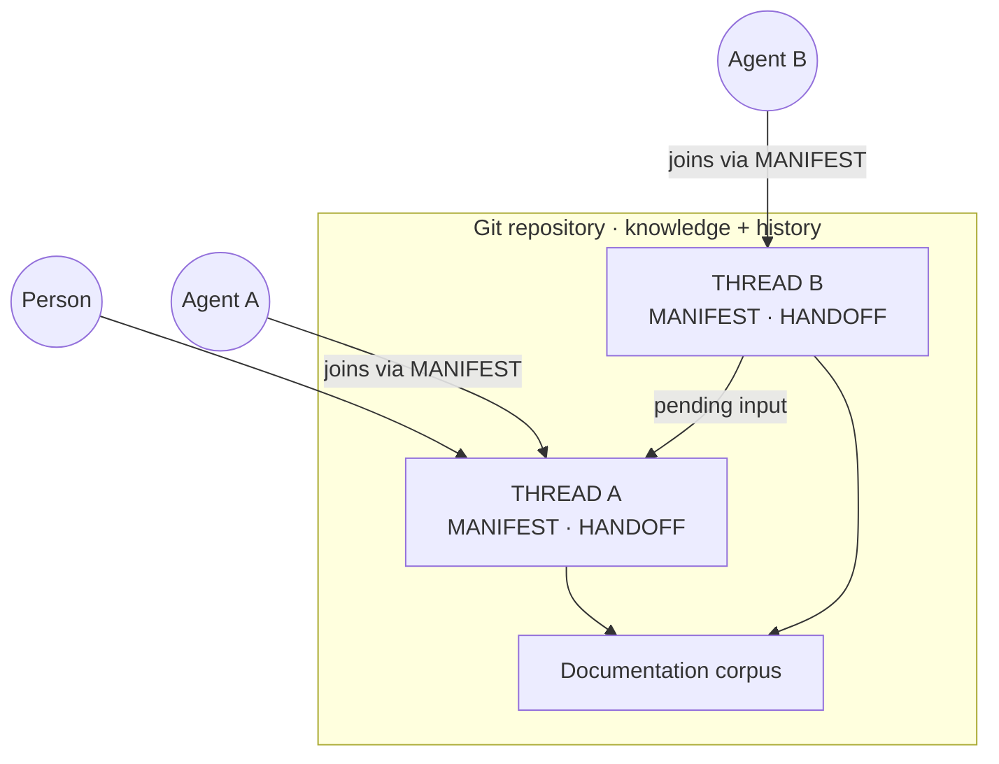

# Warp

> **Note:** this repository's documentation and code are written in Spanish. This README is an English summary for readers who don't read Spanish. → [Leer en español](README.es.md)

> A knowledge architecture for coordinating work between people and AI agents without depending on the memory of any single conversation.

Warp is a methodology and a Git-based working architecture. Its goal is to keep **knowledge, responsibility, and state** persistent when a project is spread across multiple conversations, agents, or tools that don't share memory with each other.

The core idea is simple:

> **the conversation is ephemeral; the repository is the durable memory.**

Warp didn't start as an abstract architecture exercise. It emerged during the **Design to Code** research, when it became clear that a staged methodology could structure the process well, but couldn't by itself solve a different problem: **how to coordinate isolated contexts without losing coherence, traceability, or responsibility**.

→ Originating research: [Design to Code](https://github.com/gineslm/design-to-code)

---

## 1. The problem

Working with AI agents produces useful knowledge, but that knowledge tends to end up scattered across conversations:

- one instance researches;
- another designs;
- another implements;
- another reviews;
- none of them automatically shares the others' memory.

As the work grows, several symptoms appear:

- repeated or contradictory decisions;
- context that has to be rebuilt over and over;
- difficulty knowing what the current state actually is;
- responsibilities mixed within a single conversation;
- excessive dependence on the memory of the agent or the person who was present;
- important knowledge trapped in conversation histories.

The problem isn't only about storage.

It's also about **responsibility**:

> Who can change what? How does a proposal reach whoever has the authority to resolve it? How does a new agent get onboarded without redoing the whole history?

Warp tries to answer those questions with a small, explicit model.

---

## 2. Where it comes from

The [Design to Code](https://github.com/gineslm/design-to-code) research studied an agent-assisted flow:

```text
definition
   ↓
design
   ↓
implementation
```

That work produced a methodology based on principles such as:

- ambiguity reduction;
- traceability;
- cumulative enrichment;
- validation gates;
- controlled retroactivity;
- contracts between stages.

While that methodology was being developed, the work started to be spread across multiple conversations and tools.

That's where a second-order problem appeared:

> **instances don't share memory, and the project's state can fall out of sync.**

The first attempt to solve it used bridge documents, states, and human synchronization.

Warp was born by splitting that problem off from the design-to-code flow and turning it into its own architectural question:

> **how do you keep knowledge and responsibility coherent when multiple agents work on the same project over time?**

---

## 3. The idea: weaving knowledge

The name comes from the loom.

The **warp** is the set of parallel threads stretched across the frame that gives structure to everything woven on top of it.

In Warp, each **THREAD** is a persistent line of responsibility.

Knowledge is built around those THREADs.

Git keeps the history.

Agents are temporary and interchangeable.



---

## 4. The model

Warp explicitly separates several things that tend to get mixed together:

```text
unit of work
      ↓ 
unit of knowledge
      ↓ 
unit of authority
      ↓ 
acting agent
```

Its main pieces are:

### THREAD

A persistent line of responsibility.

It is not a conversation, a person, or an agent.

A THREAD exists if and only if its **MANIFEST** exists.

It can stay alive even as the agent working on it changes.

It can be closed and reopened.

---

### MANIFEST

The THREAD's current contract.

It declares what Git can't infer on its own:

- identity;
- responsibility;
- state;
- scope;
- document authority;
- relevant dependencies;
- associated HANDOFF.

The agent joins the THREAD by reading its MANIFEST.

---

### HANDOFF

A THREAD's persistent inbox.

It contains exclusively **pending inputs coming from other THREADs**:

- proposals;
- reviews;
- needs;
- inter-THREAD tasks.

A THREAD's own work is not queued in its own HANDOFF.

The receiving THREAD evaluates and resolves each entry.

When an entry is resolved, it's removed in the same commit that applies or logs the decision.

So:

```text
HANDOFF = pending present
Git     = resolved past
```

---

### Documentation corpus

The corpus is shared for reading.

Any THREAD can consult the knowledge it needs.

But each document has a **single authority for evolving it**.

```text
reading
→ global

editing
→ explicit authority
```

If a THREAD needs to modify knowledge under another THREAD's authority, it doesn't edit it directly: it proposes the change through the responsible THREAD's HANDOFF.

---

### Git

Git is the historical substrate.

It preserves:

- authorship;
- dates;
- diffs;
- previous states;
- the evolution of decisions.

Warp avoids manually duplicating information Git already knows.

---

## 5. How knowledge moves

The basic rule is:

```text
THREAD A
  ↓
  ↓ needs to change knowledge under B's authority
  ↓
HANDOFF B
  ↓
  ↓
THREAD B evaluates
  ↓
  ↓
document under B's authority
```

This lets knowledge be cross-cutting without turning editing into a shared, ambiguous responsibility.

When a document is cross-cutting and no existing responsibility should own it, Warp allows for creating a dedicated management THREAD with sole authority over that document.

---

## 6. Interchangeable agents

The agent is not the project's memory.

A new agent should be able to rebuild the context it needs from the repository:

```text
minimal context
      ↓
indexes
      ↓
MANIFEST
      ↓
HANDOFF
      ↓
relevant corpus
```

This allows switching:

- conversation;
- instance;
- model;
- tool;

without redefining the THREAD.

The agent is a temporary actor.

Responsibility persists.

---

## 7. Minimal surface

Warp adopts **progressive disclosure**.

An agent doesn't load the entire architecture or all the rules by default.

It reads only what's needed for ordinary work and consults more extensive documentation only when the operation requires it.

The entry surface is:

```text
PROJECT_AGENT_CONTEXT
        ↓
THREAD_INDEX / DOCUMENT_INDEX
        ↓
MANIFEST
        ↓
HANDOFF
        ↓
relevant corpus
```

Full rules are loaded on demand for operations such as:

- creating a THREAD;
- changing document authority;
- resolving HANDOFFs;
- closing or reopening responsibilities;
- modifying the architecture itself.

Reducing context does not reduce obligations.

---

## 8. Structural validation

Invariants that can be checked mechanically shouldn't depend only on manual discipline.

Warp includes:

```bash
# in an instance, from its root
python warp/scripts/check_knowledge.py

# in this repository, on the example instance
python warp/scripts/check_knowledge.py examples/minimal
```

The checker validates, among other things:

- existence and coherence of THREADs;
- the MANIFEST → HANDOFF relationship;
- index consistency;
- declared document authority;
- file references;
- recognizable structure of HANDOFF entries;
- basic secret patterns.

The checker doesn't replace human judgment.

It doesn't decide whether:

- a responsibility is well formulated;
- a decision is correct;
- a change conceptually belongs to a THREAD;
- a semantic dependency is valid.

It automates structure, not judgment.

---

## 9. Design principles

### One commit = one decision

A commit tries to represent a coherent unit of change.

Its message explains why the knowledge changed, not just which lines were edited.

### Git holds the history; documents represent the present

No second, manual history is maintained on top of Git.

### Global reading, explicit write authority

The corpus can be shared without the ability to modify it being diffuse.

### Interchangeable agents

The system doesn't depend on preserving any specific conversation.

### HANDOFF only for inter-THREAD work

A THREAD's own work is resolved within the THREAD and materialized directly in documents under its authority.

### Explicit provenance only when it adds meaning

Editorial authorship, date, and diff already live in Git.

Provenance relationships that do carry epistemic meaning can be declared explicitly.

### Progressive context loading

The minimum necessary is read, and only expanded when the operation requires it.

---

## 10. What Warp is not

Warp doesn't claim to be:

- a multi-agent platform;
- an autonomous orchestrator;
- a vector memory for LLMs;
- a ticketing system;
- a replacement for Git;
- a knowledge graph;
- a claim of having invented novel primitives.

It's a working architecture for **producing and evolving durable knowledge with agents**.

---

## 11. Relationship to Design to Code

Design to Code and Warp are part of the same lineage, but they answer different questions.

### Design to Code

Main question:

> **how should an agent-assisted process move forward and be validated?**

Result:

- experimental research;
- staged methodology;
- contracts between layers;
- ambiguity reduction;
- traceability;
- gates;
- specs;
- fidelity and replicability evaluation.

### Warp

Main question:

> **how do you keep knowledge and responsibility coherent when multiple agents work without sharing memory?**

Result:

- persistent THREADs;
- MANIFESTs;
- HANDOFFs;
- document authority;
- shared corpus;
- Git as history;
- interchangeable agents;
- minimal surface;
- structural validation.

The relationship can be summarized as:

```text
Design to Code
→ investigates a process
→ extracts a methodology
→ discovers a coordination problem

Warp
→ takes that problem
→ abstracts it
→ develops a knowledge architecture
```

→ [See Design to Code](https://github.com/gineslm/design-to-code)

---

## 12. Critical evaluation

Warp doesn't invent from scratch concepts such as:

- ownership;
- shared memory;
- bounded contexts;
- decision records;
- message passing;
- traceability;
- federated governance;
- versioning as history.

The model was later compared against families such as:

- DDD / Bounded Contexts;
- Data Mesh;
- ADR;
- RFC;
- IBIS;
- W3C PROV;
- Team Topologies;
- Blackboard architectures;
- Git-based systems.

Warp's interest isn't in claiming a novel primitive.

It's in the **synthesis** applied to a concrete human–AI collaboration problem, and in making explicit the separation between:

```text
responsibility
knowledge
authority
agent
history
```

Building the architecture was also a research instrument: it made it possible to understand the decisions from the inside before comparing them against existing models.

---

## 13. Status

Warp is published as a small, readable methodology, not as a platform.

The core includes:

- architecture;
- operating rules;
- agent bootstrap;
- minimal context;
- Git rules;
- templates;
- indexes;
- coherence checker;
- minimal example.

Future directions are outside the current core:

- automated CI for the checker;
- dependency warnings;
- semantic corpus querying;
- possible graph projection;
- experimentation with multiple users and roles.

---

## 14. Repository structure

```text
.
├── README.md
├── README.es.md
├── AGENTS.md
├── INSTALL.md
├── LICENSE
├── LICENSE-CODE
├── LICENSE-DOCS
│
├── warp/                          # the method: what a project adopts
│   ├── VERSION
│   ├── core/
│   │   ├── THREAD_ARCHITECTURE.md
│   │   ├── PROJECT_WORKING_RULES.md
│   │   ├── THREAD_CONTEXT_BOOTSTRAP.md
│   │   ├── PROJECT_AGENT_CONTEXT.md
│   │   ├── GIT_COMMIT_RULES.md
│   │   └── *_TEMPLATE.md
│   └── scripts/
│       ├── check_knowledge.py
│       └── warp.py
│
├── examples/
│   └── minimal/                   # example instance (uses the method in this repository's `warp/`)
│       ├── warp.yaml
│       ├── USERS.md
│       ├── index/
│       │   ├── THREAD_INDEX.md
│       │   └── DOCUMENT_INDEX.md
│       ├── threads/
│       │   ├── governance/
│       │   │   ├── MANIFEST.md
│       │   │   └── handoff/
│       │   └── example-notes/
│       │       ├── MANIFEST.md
│       │       └── handoff/
│       │           └── explicar-registro-de-entradas.md
│       └── corpus/
│           └── NOTES.md
│
├── tests/
│   ├── test_check_knowledge.py
│   ├── test_warp_init.py
│   └── test_build_package.py
│
├── tools/
│   └── build_package.py
│
└── docs/
    └── evaluaciones/
```

`docs/evaluaciones/` collects evaluation reports and evolution proposals that aren't yet part of the canonical core: they aren't current methodology, they're analysis and triggers for future decisions.

To install Warp in a project, follow [`INSTALL.md`](INSTALL.md) (in Spanish).

---

## 15. License

Warp is distributed under a dual license: code (`warp/scripts/`, `tests/`, `tools/`) under **MIT**, and documentation and methodology (`warp/core/`, `examples/`, `docs/`, `README.md`) under **CC BY-SA 4.0**.

See [`LICENSE`](LICENSE), [`LICENSE-CODE`](LICENSE-CODE), and [`LICENSE-DOCS`](LICENSE-DOCS).

---

## Author

**Ginés López Montalbán**

Design Engineer · Product Design / UX-UI · Frontend · Design Systems · AI-agent processes and collaboration

[Online profile](https://www.dsigncloud.es/dosier/en/)
